  

### 👋 Oi, eu sou o Cledilson

Desenvolvedor de software há **6 anos**, especialista em **mobile com Flutter**. Crio apps para Android e iOS do primeiro commit até a publicação nas lojas, com arquitetura limpa e foco em quem vai usar. Também tenho **Kotlin, Swift, Java e Python** na bagagem.

- 📱 Fundador da **Recomece Mulher**, empresa de apps de cuidados pessoais femininos. O **Raízes** já passou de **400 mil downloads**.
- ☕ Criei a **[Unidunedev](https://github.com/unidunedev)**, uma comunidade para jovens aprenderem programação, Git e trabalho em equipe na prática.
- 🪖 Ex-militar: disciplina, foco e missão dada é missão cumprida.
- 🎮 Gamer nas horas vagas.

  

### 🚀 Projetos em destaque

| Projeto | O que é |
| --- | --- |
| **Recomece Mulher** | Apps de cuidados pessoais femininos. O **Raízes** tem mais de 400 mil downloads. [Ver na Google Play ↗](https://play.google.com/store/apps/details?id=company.mms2.empoderamentoblackpower) |
| **[Unidunedev](https://github.com/unidunedev)** | Comunidade dev universitária: [onboarding](https://onboarding.unidunedev.workers.dev) com mural via Pull Request e [site de estudos](https://estudos.unidunedev.workers.dev) com trilhas de lógica, linguagens e profissões. |
| **Help Entregas** | Apps de entrega em Flutter: o app de quem pede e o app do entregador. |

### 🧰 Ferramentas

  
  
  
  
  
  
  
  
  
  
  

### 🐍 A cobrinha comendo meus commits

<picture>
  <source media="(prefers-color-scheme: dark)" srcset="https://raw.githubusercontent.com/clehdev/clehdev/output/snake-escuro.svg">
  <source media="(prefers-color-scheme: light)" srcset="https://raw.githubusercontent.com/clehdev/clehdev/output/snake-claro.svg">
  
</picture>

### 📫 Bora conversar?

  
  
  

🇺🇸 <b>English</b>

 

Hi! I'm **Cledilson**, a software developer with **6 years of experience**, specialized in **mobile development with Flutter** (Android and iOS), also working with Kotlin, Swift, Java and Python.

- Founder of **Recomece Mulher**, a company of personal care apps for women. Our app **Raízes** has over **400k downloads**.
- Creator of **[Unidunedev](https://github.com/unidunedev)**, a community that helps young people learn programming, Git and teamwork by building real projects.
- Former military (discipline and focus) and a gamer at heart.

Capa e ficha animadas feitas à mão em SVG + CSS · com café ☕

